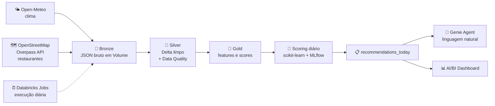

<div align="center">

# 🌦️🍕 Weather Food Recommendation

### Pipeline de Engenharia de Dados no Databricks que recomenda comida de acordo com o clima


</div>

---

## 🎯 O problema de negócio

Em dias de **chuva** ou de **calor intenso**, apps de delivery (iFood, Keeta e similares) recomendam comidas e restaurantes diferentes, usando clima, horário e localização do usuário.

Este projeto reproduz esse conceito **de ponta a ponta**, do dado bruto até a recomendação final: ingestão de APIs, tratamento, qualidade, orquestração diária, score de recomendação e consulta em linguagem natural.

> 💡 Chuva e frio → sopas, caldos, massas e comfort food
> ☀️ Calor intenso → açaí, sorvete, saladas e bebidas geladas

---

## 🏗️ Arquitetura



### 🧱 Camadas (Arquitetura Medalhão)

| Camada | O que guarda | Formato |
|---|---|---|
| 🥉 **Bronze** | Resposta bruta das APIs, sem nenhuma alteração | JSON em Volume |
| 🥈 **Silver** | Dados limpos, tipados, deduplicados e validados | Delta |
| 🥇 **Gold** | Tags de clima, features dos restaurantes e score de recomendação | Delta |

---

## 🛠️ Stack (100% gratuita)

| Tema | Ferramenta |
|---|---|
| ☁️ Plataforma | Databricks Free Edition (serverless) |
| 🌤️ API de clima | [Open-Meteo](https://open-meteo.com/) (sem chave, previsão e histórico) |
| 🍽️ API de restaurantes | [OpenStreetMap via Overpass API](https://overpass-api.de/) (sem chave) |
| 💾 Armazenamento | Delta Lake + Unity Catalog Volumes |
| ⚙️ Orquestração | Databricks Jobs |
| ✅ Qualidade de dados | PySpark + validações próprias |
| 🧠 Machine Learning | scikit-learn / LightGBM + MLflow |
| 💬 IA conversacional | Genie Agent sobre as tabelas Gold |
| 📈 Visualização | AI/BI Dashboard |
| 🔀 Versionamento | Git + GitHub (Git folders do Databricks) |

---

## 🗂️ Estrutura do repositório

```
Weather-Food-Recommendation/
├── 📓 01_teste_conectividade    → testa a chamada à Open-Meteo
├── 📓 02_teste_overpass         → testa a chamada ao Overpass
├── 📓 03_setup_ambiente         → cria schemas bronze/silver/gold e o Volume
├── 📓 04_bronze_clima           → ingestão do clima (previsão + histórico)
├── 📄 README.md
└── 📄 .gitignore
```

> A estrutura vai crescer conforme as camadas Silver e Gold forem desenvolvidas.

---

## 🗺️ Roadmap

### ✅ Concluído
- [x] Repositório criado e integrado ao Databricks (Git folder)
- [x] Teste de acesso à API de clima (Open-Meteo)
- [x] Teste de acesso à API de restaurantes (Overpass)
- [x] Schemas `bronze`, `silver`, `gold` e Volume `raw_files` criados

### 🔄 Em andamento
- [ ] Ingestão do clima de São Paulo na Bronze (previsão + histórico)

### 📌 Próximos passos
- [ ] Ingestão dos restaurantes na Bronze
- [ ] Silver com Data Quality (nulos, faixas válidas, duplicados e tabela de rejeitados)
- [ ] Carga idempotente com `MERGE`
- [ ] Gold com tags de clima (`chuvoso`, `calor_intenso`, `frio`)
- [ ] Score de recomendação **V1** (baseado em regras)
- [ ] Job diário de orquestração
- [ ] AI/BI Dashboard
- [ ] Genie Agent sobre as tabelas Gold
- [ ] Pedidos simulados + modelo de ML **V2** com MLflow e comparação com a V1

---

## 🧮 Como a recomendação funciona

As APIs abertas dizem **onde** o restaurante está e **que tipo de cozinha** ele serve, mas não dizem se ele é bom. Por isso o score é construído pelo próprio pipeline:

1. **V1 – Regras:** `score = afinidade(clima, cozinha) × proximidade × aberto agora`
2. **V2 – Machine Learning:** modelo de ranking treinado com pedidos simulados e comparado com a V1 por métricas offline

---

## ⚠️ Transparência sobre os dados

| Dado | Origem |
|---|---|
| 🌡️ Clima | **Real** (Open-Meteo) |
| 🍴 Restaurantes | **Real** (OpenStreetMap) |
| 🛒 Pedidos e preferências dos usuários | **Simulados** (apenas para treinar e demonstrar a V2) |

Informações como horário de funcionamento e tipo de cozinha podem estar ausentes no OpenStreetMap. O tratamento desses casos é feito na camada Silver.

---

## 🔒 Limites do Databricks Free Edition

- 🚫 Uso não comercial (projeto de portfólio)
- ⏱️ Cota de compute: se estourar, o processamento pausa até renovar
- 🌐 Acesso à internet restrito a domínios permitidos (Open-Meteo e Overpass foram testados e funcionam)
- 📍 O escopo começa em **uma cidade (São Paulo)** para respeitar a cota

---

## 🚀 Como reproduzir

1. 🍴 Faça um fork ou clone este repositório
2. ☁️ Crie uma conta no [Databricks Free Edition](https://www.databricks.com/learn/free-edition)
3. 🔗 Em **Settings → Linked accounts**, conecte o GitHub e instale o app no repositório
4. 📂 Em **Workspace → Create → Git folder**, clone o repositório
5. ▶️ Execute os notebooks na ordem numérica

---

## 👤 Autor

**Felipe Banciella**
🔗 [github.com/banciella](https://github.com/banciella)

---

<div align="center">

⭐ Se curtiu o projeto, deixa uma estrela!

</div>
