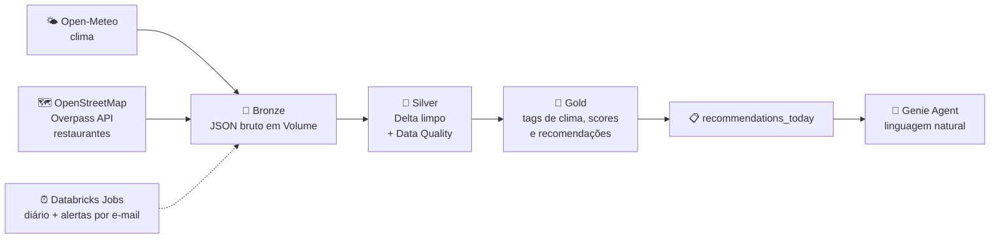

<div align="center">

# 🌦️🍕 Weather Food Recommendation

### Pipeline de Engenharia de Dados no Databricks que recomenda comida de acordo com o clima


</div>

---

## 🎯 O problema de negócio

Em dias de **chuva** ou de **calor intenso**, apps de delivery recomendam comidas e restaurantes diferentes, usando clima, horário e localização do usuário.

Este projeto reproduz esse conceito **de ponta a ponta**: ingestão de duas APIs abertas, tratamento com qualidade de dados, orquestração diária, score de recomendação e consulta em linguagem natural.

> 🌧️ Chuva e frio → sopas, caldos, massas e comfort food
> ☀️ Calor intenso → açaí, sorvete, saladas e comidas leves

---

## 🏗️ Arquitetura



### 🧱 Camadas (Arquitetura Medalhão)

| Camada | O que guarda | Tabelas |
|---|---|---|
| 🥉 **Bronze** | Resposta bruta das APIs, sem alteração | JSONs em Volume (`weather/` e `restaurants/`) |
| 🥈 **Silver** | Dados limpos, tipados, deduplicados e validados | `weather_hourly`, `restaurants` e as tabelas `_rejected` |
| 🥇 **Gold** | Tags de clima, scores e recomendações | `weather_context`, `dim_afinidade_clima_comida`, `recommendation_scores`, `recommendations_today` |

---

## 🛠️ Stack (100% gratuita)

| Tema | Ferramenta |
|---|---|
| ☁️ Plataforma | Databricks Free Edition (serverless) |
| 🌤️ API de clima | [Open-Meteo](https://open-meteo.com/) (sem chave, previsão e histórico) |
| 🍽️ API de restaurantes | [OpenStreetMap via Overpass API](https://overpass-api.de/) (sem chave) |
| 💾 Armazenamento | Delta Lake + Unity Catalog Volumes |
| ⚙️ Orquestração | Databricks Jobs (5 tasks em sequência) |
| 🔔 Monitoramento | Alertas por e-mail (falha e duração) |
| ✅ Qualidade de dados | PySpark + regras próprias + tabelas de rejeitados |
| 💬 IA conversacional | Genie Agent sobre as tabelas Gold |
| 🔀 Versionamento | Git + GitHub (Git folders do Databricks) |

---

## 🗂️ Notebooks

```
Weather-Food-Recommendation/
├── 📓 03_setup_ambiente              → schemas bronze/silver/gold + Volume
├── 📓 04_bronze_clima                → previsão (7 dias) e histórico (30 dias)
├── 📓 05_bronze_restaurantes         → restaurantes de São Paulo (Overpass)
├── 📓 06_silver_clima                → limpeza, Data Quality e MERGE
├── 📓 07_silver_restaurantes         → classificação de comida, Data Quality e MERGE
├── 📓 08_gold_afinidade              → nota de afinidade clima x categoria
├── 📓 09_gold_weather_context        → tag de clima de cada hora
├── 📓 10_gold_recommendation_scores  → score base por restaurante e clima
├── 📓 11_gold_recommendations_today  → recomendações da hora atual + função recomendar(lat, lon)
├── 📓 12_gold_genie_metadata         → descrições das tabelas para o Genie
└── 📄 README.md
```

---

## 🧮 Como a recomendação funciona

As APIs abertas dizem **onde** o restaurante está e **que tipo de comida** ele serve, mas não dizem se ele é bom. Por isso o score é construído pelo próprio pipeline:

1. 🌡️ **Clima da hora vira uma tag:** `chuvoso`, `frio`, `ameno` ou `calor_intenso` (chuva tem prioridade sobre calor e frio)
2. 🍜 **Cada restaurante vira uma categoria:** 13 categorias + `geral`, definidas por cuisine, nome ou amenity (nessa ordem)
3. 💞 **Afinidade clima x categoria:** nota de 0 a 1 definida pelo projeto
4. 🕐 **Aberto agora:** parser do `opening_hours` do OpenStreetMap (fechado sai, desconhecido tem peso menor)
5. 📍 **Proximidade:** a função `recomendar(lat, lon)` pondera pela distância do usuário

`score = afinidade × confiança da classificação × fator de horário × proximidade`

---

## ✅ Qualidade de dados e boas práticas

- 🔁 **Idempotência:** Silver com `MERGE`, então rodar de novo não duplica dados
- 🚫 **Rejeitados separados:** registros inválidos vão para tabelas `_rejected`, com o motivo
- 🧪 **Validações no código:** `assert` nos notebooks Gold fazem a task falhar se algo estiver errado
- 📊 **Resultado atual:** 5.006 restaurantes únicos na Silver, sem duplicados e com 17,9% em `geral` (sem pista de comida no nome ou na cozinha)
- 🔔 **Alertas:** e-mail em caso de falha ou de duração acima do esperado

---

## ⚙️ Orquestração

Job `Weather_food_daily`, com 5 tasks em sequência:

```
Ingest_clima → silver_clima → gold_clima → gold_scores → gold_recomendacoes_hoje
```

- ⏱️ Execução completa em cerca de **5 minutos**
- 🕖 Agendamento diário por cron, com fuso `America/Sao_Paulo`
- 🔄 Retry na ingestão, que depende de API externa
- 🍽️ Restaurantes mudam pouco, então ficam num job semanal separado (ver roadmap)

---

## 🗺️ Roadmap

### ✅ Concluído
- [x] Repositório integrado ao Databricks (Git folder)
- [x] Bronze de clima e de restaurantes
- [x] Silver com Data Quality, tabelas de rejeitados e `MERGE`
- [x] Gold: tags de clima, afinidade, scores e recomendações do dia
- [x] Job diário com 5 tasks, agendamento e alertas por e-mail
- [x] Descrições das tabelas no Unity Catalog para o Genie

### 🔄 Em andamento
- [ ] Genie Agent sobre as tabelas Gold (instruções, SQLs de exemplo e perguntas de teste)

### 📌 Próximos passos
- [ ] Task `12_gold_genie_metadata` no job, para reaplicar as descrições após cada regravação
- [ ] Job semanal dos restaurantes (`05` e `07`)
- [ ] Agente em código que usa o Genie e a função de recomendação como ferramentas, e explica a sugestão em linguagem natural
- [ ] Pedidos simulados + modelo de ML **V2**, comparado com a V1 (regras)
- [ ] Dashboard (AI/BI)
- [ ] Demo em vídeo curto

---

## ⚠️ Transparência sobre os dados

| Dado | Origem |
|---|---|
| 🌡️ Clima | **Real** (Open-Meteo) |
| 🍴 Restaurantes | **Real** (OpenStreetMap) |
| 💞 Afinidade clima x comida | **Hipótese do projeto**, não é dado observado |
| 🛒 Pedidos e preferências (V2) | **Simulados**, só para treinar e demonstrar |

O OpenStreetMap não traz nota nem popularidade. Por isso a V1 é baseada em regras, e não em avaliação de clientes. Horário de funcionamento e tipo de cozinha também podem estar ausentes, e a Silver trata esses casos.

---

## 🔒 Limites do Databricks Free Edition

- 🚫 Uso não comercial (projeto de portfólio)
- ⏱️ Cota de compute: se estourar, o processamento pausa até renovar
- 🌐 Acesso à internet restrito a domínios permitidos (Open-Meteo e Overpass funcionam)
- 🖥️ Um único SQL warehouse pequeno, então evito rodar o job e o Genie ao mesmo tempo
- 📍 Escopo atual: **uma cidade (São Paulo)**

---

## 🚀 Como reproduzir

1. 🍴 Faça um fork ou clone este repositório
2. ☁️ Crie uma conta no [Databricks Free Edition](https://www.databricks.com/learn/free-edition)
3. 🔗 Em **Settings → Linked accounts**, conecte o GitHub e instale o app no repositório
4. 📂 Em **Workspace → Create → Git folder**, clone o repositório
5. ▶️ Execute os notebooks na ordem numérica (03 a 12)
6. ⚙️ Crie o job com as 5 tasks na ordem da seção de orquestração

---

## 👤 Autor

**Felipe Banciella**
🔗 [github.com/banciella](https://github.com/banciella)

---

<div align="center">

⭐ Se curtiu o projeto, deixa uma estrela!

</div>
